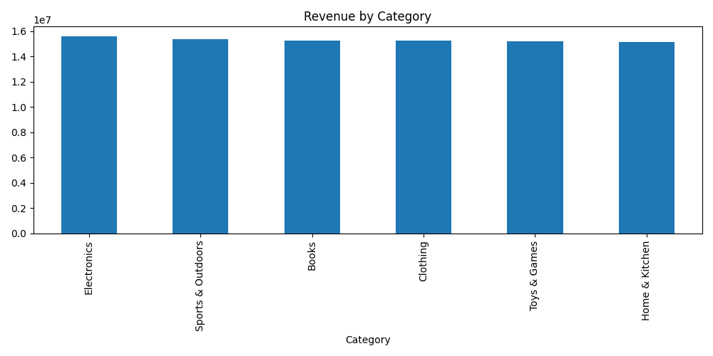
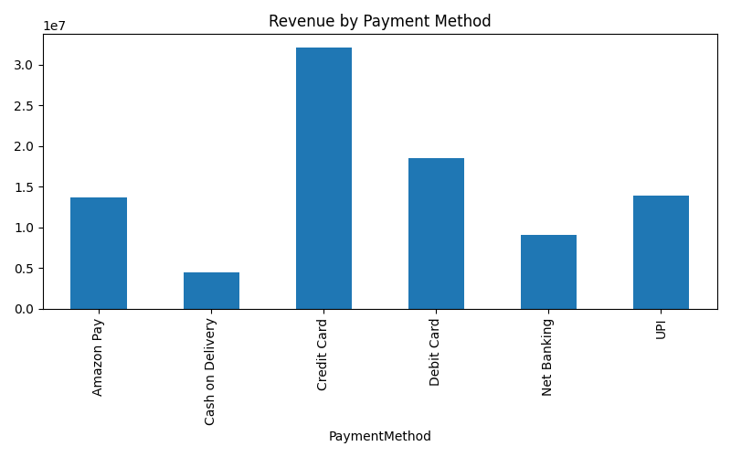
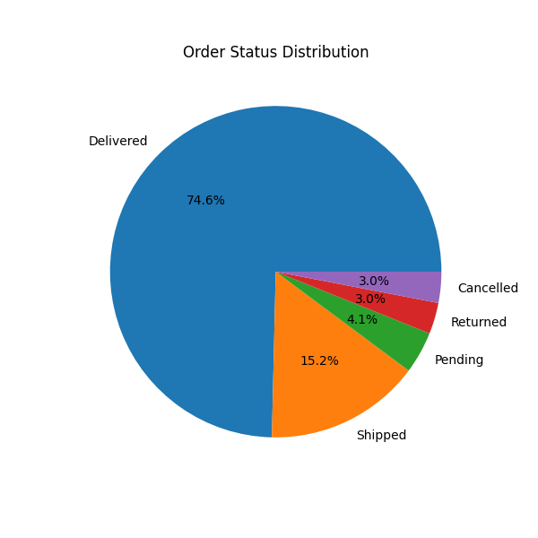
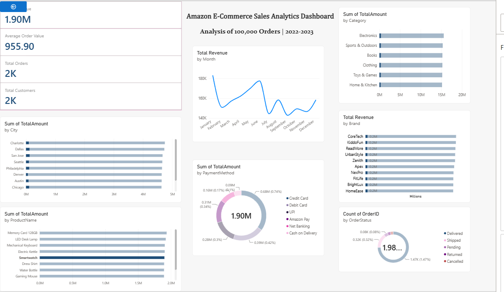

# 🛒 Amazon E-Commerce Sales Analytics

> End-to-end data analytics project analyzing **100,000 Amazon orders** to uncover sales trends, customer behavior, product performance, and actionable business insights — visualized through a Power BI dashboard.

---

## 📋 Table of Contents
- [Project Overview](#project-overview)
- [Dataset Information](#dataset-information)
- [Project Structure](#project-structure)
- [Technologies Used](#technologies-used)
- [Project Workflow](#project-workflow)
- [Key Insights](#key-insights)
- [Dashboard](#dashboard)
- [Business Recommendations](#business-recommendations)

---

## 📌 Project Overview

This project performs a comprehensive analysis of Amazon e-commerce sales data. The goal is to help businesses make data-driven decisions by identifying top-performing products, revenue trends, geographic hotspots, and customer payment preferences.

**Business Objectives:**
- Analyze overall sales performance and revenue trends
- Identify top-selling categories, products, and brands
- Evaluate customer purchasing and payment behavior
- Study geographic revenue distribution
- Monitor order status performance
- Generate actionable business recommendations

---

## 📊 Dataset Information

| Attribute | Detail |
|-----------|--------|
| **Records** | 100,000 orders |
| **Columns** | 20 features |
| **Raw Data** | `data/raw/Amazon.csv` |
| **Cleaned Data** | `data/cleaned/amazon_cleaned.csv` |

---

## 🗂️ Project Structure

```
amazon-sales-analytics/
│
├── data/
│   ├── raw/                        # Original dataset
│   │   └── Amazon.csv
│   └── cleaned/                    # Processed dataset
│       └── amazon_cleaned.csv
│
├── notebooks/
│   ├── 01_data_cleaning.py         # Data cleaning & preprocessing
│   ├── 02_eda.py                   # Exploratory Data Analysis
│   ├── 03_business_analysis.py     # Business KPI analysis
│   └── 04_sales_trend_analysis.py  # Sales trend analysis
│
├── visuals/
│   ├── category_revenue.png        # Revenue by category chart
│   ├── payment_revenue.png         # Revenue by payment method
│   └── order_status.png            # Order status distribution
│
├── dashboard/
│   └── image.png                   # Power BI dashboard screenshot
│
├── report/
│   └── business_insights.md        # Detailed business insights report
│
└── README.md
```

---

## 🛠️ Technologies Used

| Tool | Purpose |
|------|---------|
| **Python** | Core programming language |
| **Pandas** | Data manipulation & cleaning |
| **NumPy** | Numerical computations |
| **Matplotlib** | Data visualization |
| **Power BI** | Interactive dashboard |
| **Git & GitHub** | Version control |

---

## 🔄 Project Workflow

```
1. Data Cleaning          →  Handle nulls, fix types, remove duplicates
2. Exploratory Analysis   →  Distributions, correlations, outliers
3. Business Analysis      →  KPIs: revenue, categories, brands, cities
4. Sales Trend Analysis   →  Time-series & trend identification
5. Dashboard Development  →  Interactive Power BI dashboard
```

---

## 💡 Key Insights

### 📈 Revenue Overview
| Metric | Value |
|--------|-------|
| **Total Revenue** | \$91.83M |
| **Total Orders** | 100,000 |
| **Top Category** | Electronics (\$15.58M) |
| **Top Brand** | CoreTech (\$9.34M) |
| **Top City** | Charlotte (\$4.75M) |
| **Preferred Payment** | Credit Card (35,038 orders) |

### 🏆 Top 5 Products by Revenue
| Rank | Product | Revenue |
|------|---------|---------|
| 1 | Memory Card 128GB | \$1.94M |
| 2 | LED Desk Lamp | \$1.92M |
| 3 | Mechanical Keyboard | \$1.91M |
| 4 | Electric Kettle | \$1.91M |
| 5 | Smartwatch | \$1.90M |

### 📦 Top 5 Categories by Revenue
| Rank | Category | Revenue |
|------|----------|---------|
| 1 | Electronics | \$15.58M |
| 2 | Sports & Outdoors | \$15.35M |
| 3 | Books | \$15.26M |
| 4 | Clothing | \$15.25M |
| 5 | Toys & Games | \$15.22M |

### 🌍 Top 5 Cities by Revenue
| Rank | City | Revenue |
|------|------|---------|
| 1 | Charlotte | \$4.75M |
| 2 | Dallas | \$4.73M |
| 3 | San Jose | \$4.67M |
| 4 | Seattle | \$4.66M |
| 5 | Philadelphia | \$4.65M |

### 💳 Payment Method Breakdown
| Payment Method | Orders |
|---------------|--------|
| Credit Card | 35,038 |
| Debit Card | 20,024 |

---

## 📊 Visualizations

**Revenue by Category**



**Revenue by Payment Method**



**Order Status Distribution**



---

## 📱 Dashboard

Interactive Power BI dashboard built to visualize all key metrics in one place.



---

## ✅ Business Recommendations

1. **Invest in Electronics** — Highest revenue category; prioritize inventory and targeted marketing.
2. **Top-Product Focus** — Strengthen stock planning for Memory Cards, LED Lamps, and Keyboards.
3. **Geographic Expansion** — Scale promotions in Charlotte and Dallas, the top-revenue cities.
4. **Credit Card Loyalty Programs** — Majority of customers pay by credit card; offer card-specific discounts and cashback.
5. **Debit Card Growth** — Debit card is the second most-used method; tap into this segment with exclusive offers.

---

*Analyzed and visualized by [Your Name] | November 2026*
